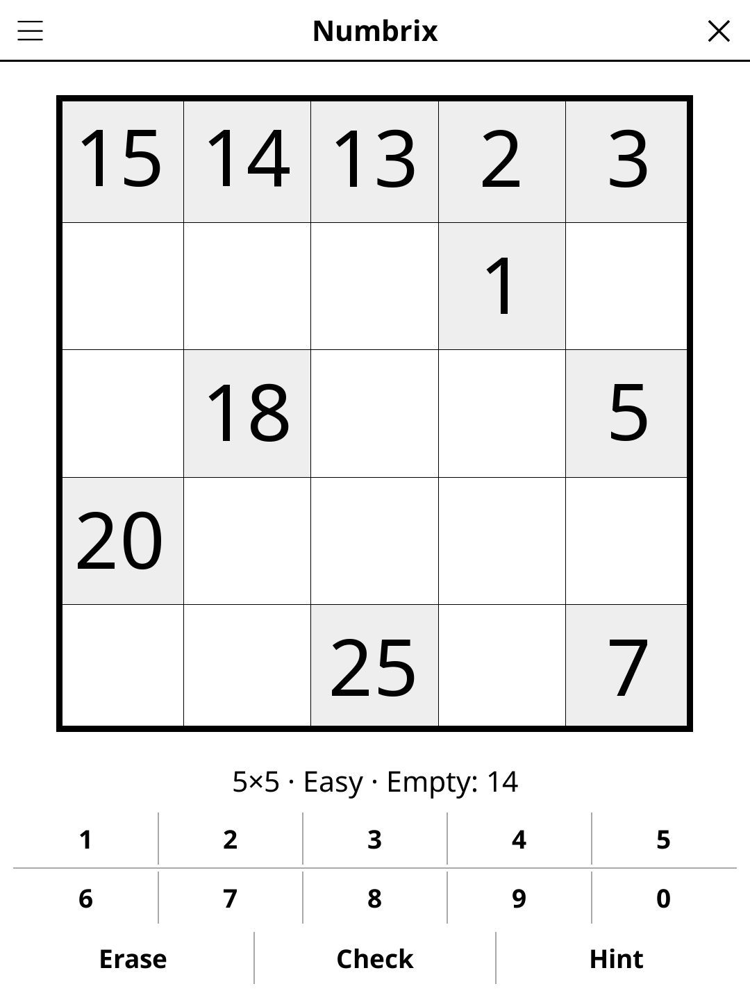

# numbrix.koplugin

A Numbrix puzzle plugin for [KOReader](https://github.com/koreader/koreader).

## Screenshot

## Rules

Fill the grid with consecutive numbers 1 to N². Each pair of consecutive numbers must be in orthogonally adjacent cells (no diagonal moves). Form a single "snake" path visiting every cell exactly once.

## Features

- **Two grid sizes** — 5×5 and 6×6
- **Three difficulty levels** — every puzzle can be solved by logic alone, with no guessing. Easy shows more numbers and needs only the simple steps (how far a number can be from its placed neighbours, a number with one possible cell, a cell only one number can reach); Medium and Hard also need the neighbour step (a number needs free neighbours for the one before and the one after), Hard with the fewest numbers shown
- **Check** — marks the numbers that are wrong
- **Hint** — two taps: the first says which cell is about to give, the second acts on it. A cell that contradicts the solution is always reported before a fresh one is revealed
- **Auto-save** — puzzle state saved and restored on next launch

## Installation

1. Download `numbrix.koplugin.zip` from the [latest release](../../releases/latest).
2. Extract into the `plugins/` folder of your KOReader data directory.
3. Restart KOReader.
4. Open the menu → **Tools** → **Numbrix**.

## Controls

| Action | How |
|--------|-----|
| Select a cell | Tap it |
| Enter a number | Type it as two digits on the keypad (0 then 7 for 7) |
| Erase a cell | Tap **Erase** |
| Check progress | Tap **Check** |
| New puzzle | Tap **New** |
| Show rules | Tap **Rules** |

## License

GPL-3.0 — see [LICENSE](LICENSE).
